<div align="center">


# AI Workspace Starter

**An open-source AI chat workspace you can build a product on.**<br />
Next.js 16 · React 19 · TypeScript · Tailwind CSS 4 · AlignUI components · a design system that checks itself.

[](https://github.com/Ayuxh-Pratap/ai-workspace-starter/actions/workflows/ci.yml)
[](./LICENSE)


[Features](#features) · [Quick start](#quick-start) · [Design system](#the-design-system) ·
[Structure](#project-structure) · [Testing](#quality-and-testing) · [Contributing](./CONTRIBUTING.md)

<br />

<picture>
  <source media="(prefers-color-scheme: dark)" srcset="docs/images/chat-dark.png" />
  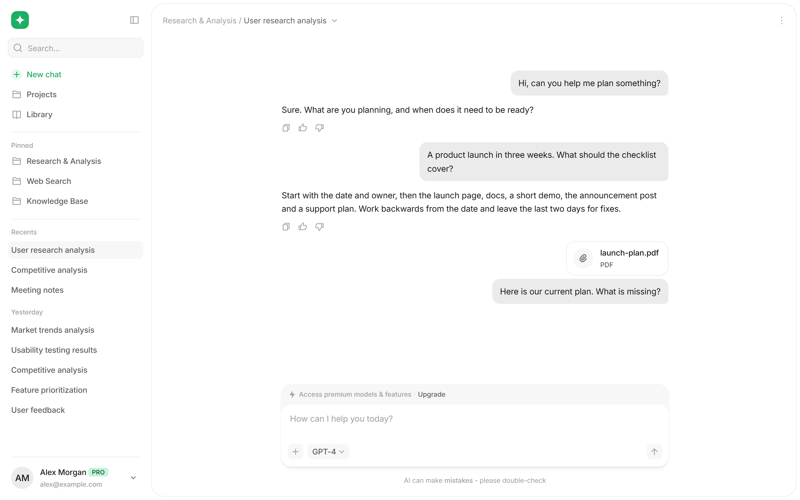
</picture>

</div>

---

## Why this exists

Most AI chat starters give you a model call and a text box. Building a real product needs the rest: an app shell
that works from phone to ultrawide, light and dark themes that never drift, settings, projects, accessible menus,
and tests that catch regressions before your users do.

This starter is that foundation. It's a complete, polished workspace with mock data behind a single data layer.
Connect your model and your API, and keep building.

## Features

|                         |                                                                                                                                                            |
| ----------------------- | ---------------------------------------------------------------------------------------------------------------------------------------------------------- |
| 🧭 **App shell**        | Sidebar that collapses to a 72px rail on desktop and becomes a drawer on mobile, with tooltips, search and chat history grouped by day.                    |
| 💬 **Chat**             | Empty state, conversation view, an auto-growing composer with a tools menu, model picker and attachments.                                                  |
| 📁 **Projects**         | Browse, search, sort and create projects; each project has its own chats, files and instructions.                                                          |
| ⚙️ **Settings**         | Eleven settings pages in one dialog that lives in the URL (`?settings=plans`): shareable, survives a reload, works with Back. A sheet on mobile.           |
| 🌗 **Light and dark**   | Every colour is a theme token; switching themes changes values, never classes. No flash on load.                                                           |
| 📐 **Design system**    | [`DESIGN.md`](./DESIGN.md) in Google's [design.md](https://github.com/google-labs-code/design.md) format, linted and checked against the CSS on every run. |
| ♿ **Accessible**       | Radix primitives (keyboard, focus, ARIA), labelled icon buttons, current-page markers, `prefers-reduced-motion`.                                           |
| 🧪 **Tested**           | Vitest unit tests and Playwright end-to-end tests at five screen widths, in CI.                                                                            |
| 🔌 **Ready to connect** | All data goes through `src/lib/data`. Swap the fixtures for your API or database; components don't change.                                                 |

## Screenshots

<table>
  <tr>
    <td width="50%">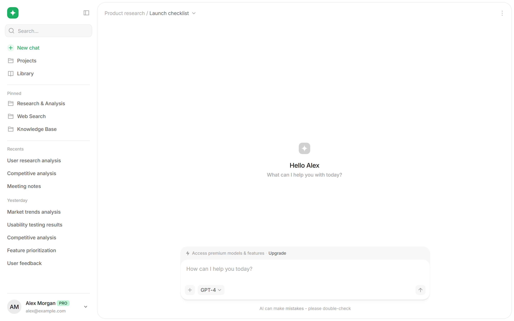</td>
    <td width="50%">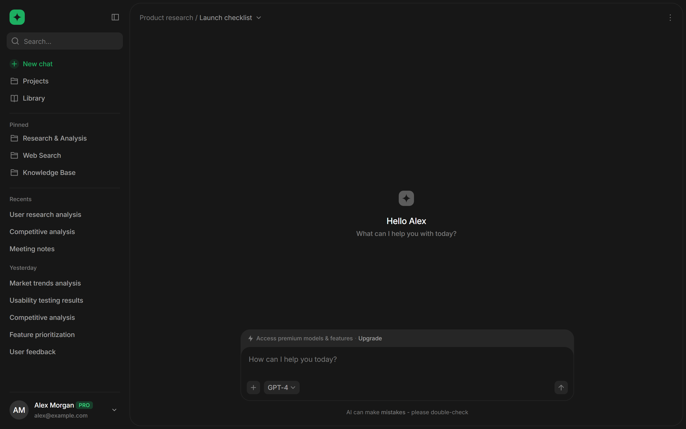</td>
  </tr>
  <tr>
    <td>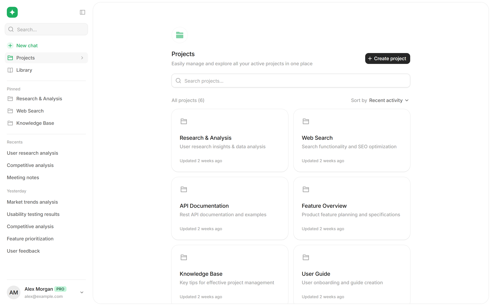</td>
    <td>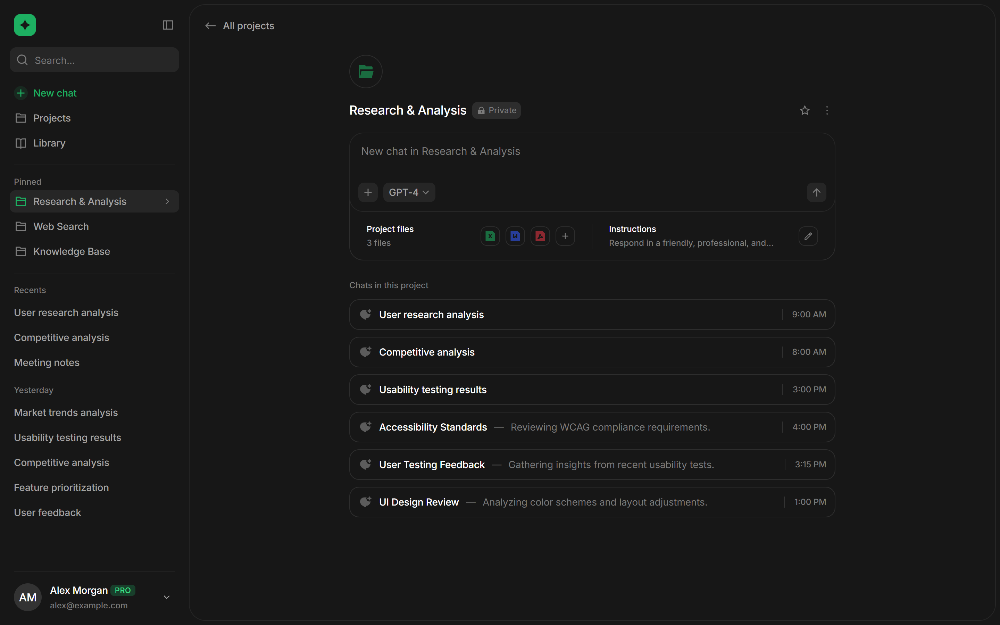</td>
  </tr>
  <tr>
    <td>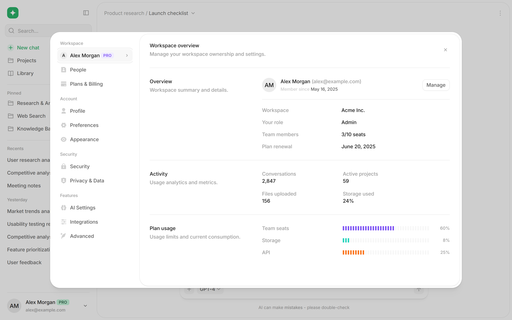</td>
    <td>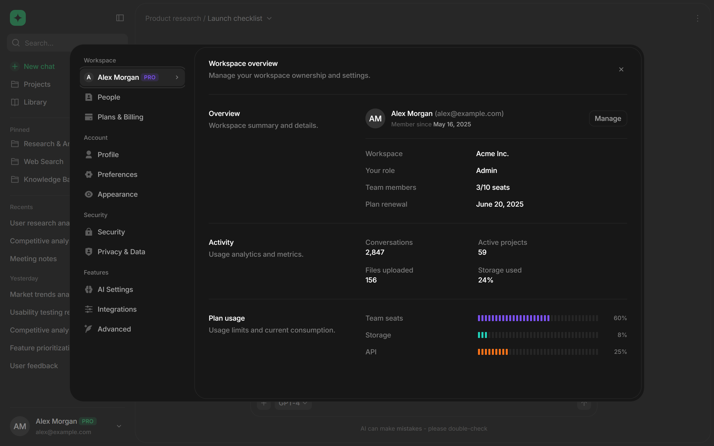</td>
  </tr>
</table>

<p align="center">
  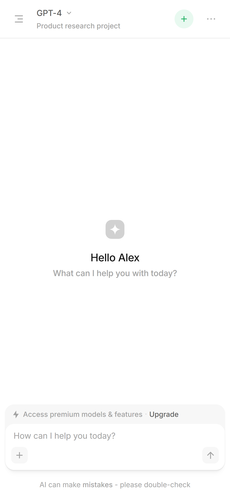
  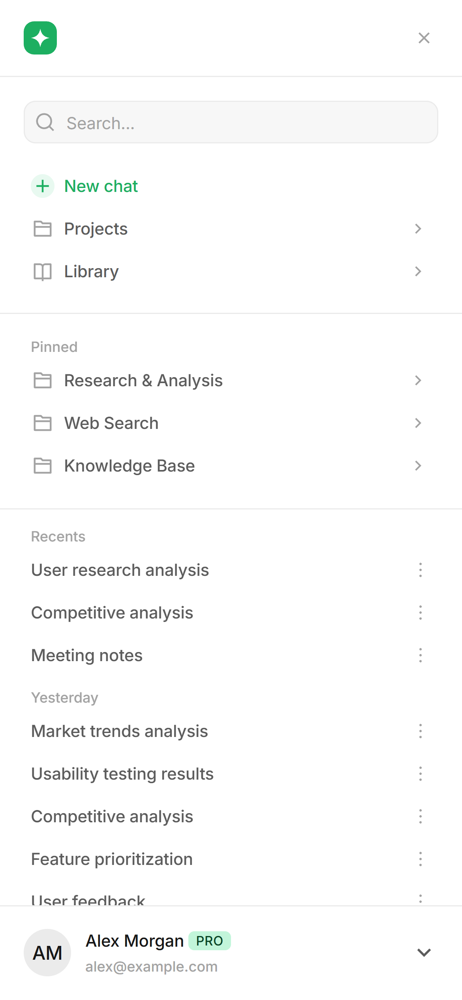
  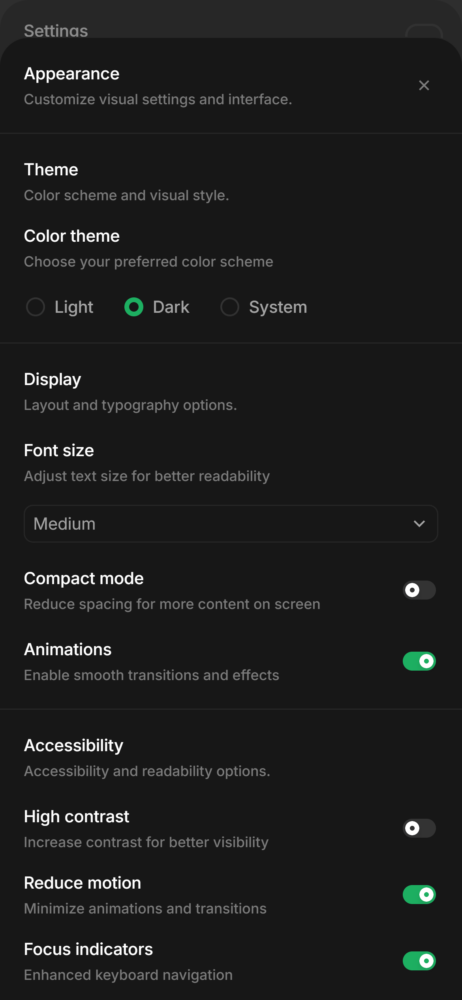
  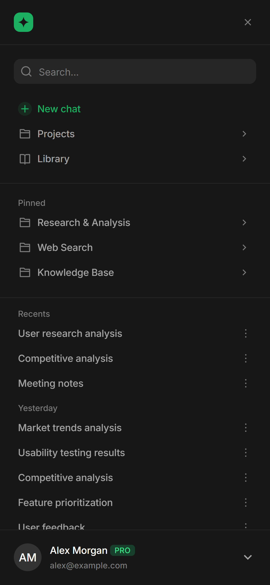
</p>

## Quick start

Requires Node.js 22.19+ (24 recommended, see `.nvmrc`).

```bash
git clone https://github.com/Ayuxh-Pratap/ai-workspace-starter.git
cd ai-workspace-starter
npm install
npm run dev
```

Open <http://localhost:3000>. Optionally copy `.env.example` to `.env.local` to set the public URL.

### Make it yours

1. **Name and links:** `src/config/site.ts`.
2. **Data:** replace the functions in `src/lib/data/index.ts` with real API or database calls. Fixtures live in
   `src/lib/data/fixtures.ts`.
3. **Your model:** wire the reply in `src/components/chat/conversation.tsx`, where the starter answers with a
   placeholder.
4. **Brand:** change the tokens in `DESIGN.md`, then the CSS (see [Changing the design](#changing-the-design)).
   The mark is `src/components/brand/logo.tsx` and `src/app/icon.svg`.

## Tech stack

| Layer      | Choice                                                                                     |
| ---------- | ------------------------------------------------------------------------------------------ |
| Framework  | Next.js 16 (App Router, Cache Components, Turbopack), React 19                             |
| Language   | TypeScript, `strict` + `noUncheckedIndexedAccess`                                          |
| Styling    | Tailwind CSS 4 with the AlignUI v1.2 token set                                             |
| Components | [AlignUI](https://www.alignui.com/docs/v1.2/introduction) free base components on Radix UI |
| Variants   | `tailwind-variants` + `tailwind-merge`                                                     |
| Icons      | Remix Icon                                                                                 |
| Theming    | `next-themes` (class strategy)                                                             |
| Validation | Zod (environment variables)                                                                |
| Quality    | ESLint, Prettier (+ Tailwind class sorting), Vitest, Testing Library, Playwright           |
| Design     | `@google/design.md` lint + a DESIGN.md ↔ CSS drift check                                   |

## The design system

`DESIGN.md` is the single source of truth for colours, type, spacing, radii, elevation and motion. It is written
for both people and coding agents, and the build refuses to let it drift from the CSS.

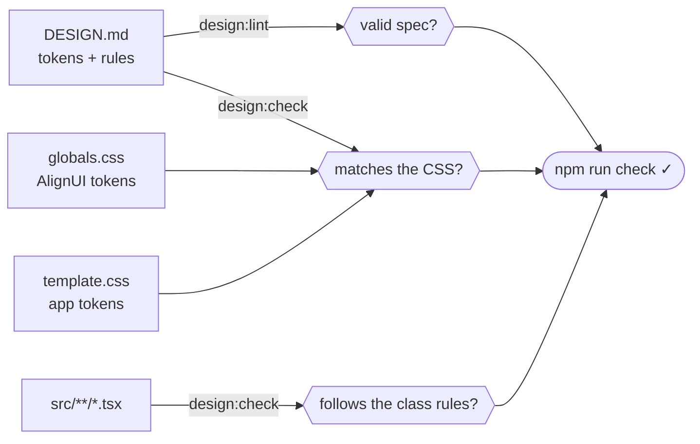

`npm run design:check` fails when:

- a value in `DESIGN.md` differs from the CSS, light or dark;
- app code uses a shadow whose dark value Tailwind can't apply (see below);
- any file uses a hard-coded colour (`bg-[#fff]`) or Tailwind v3 variable syntax (`w-[--x]`), which v4 silently
  drops.

### How light and dark work

Colours are CSS variables that the `.dark` class redefines, so one class name works in both themes. Edges are
drawn as rings, because Tailwind v4 copies a theme shadow's light value into the class and a dark override would
never reach it.

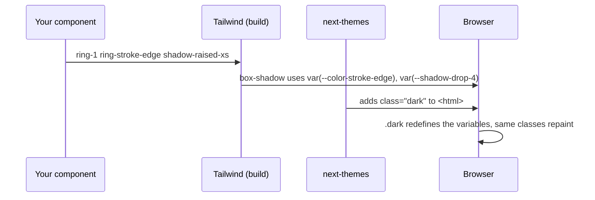

| Surface                          | Classes                                                  |
| -------------------------------- | -------------------------------------------------------- |
| Card, panel                      | `bg-bg-white-0 ring-1 ring-stroke-edge shadow-raised-xs` |
| Floating (composer, large cards) | `ring-1 ring-stroke-edge shadow-raised-sm`               |
| Dialog frame                     | `ring-1 ring-stroke-edge shadow-raised-md`               |
| Menus, popovers, selects         | AlignUI's own components (they draw their edge already)  |

### Changing the design

1. Edit the token in `DESIGN.md` (and its prose if a rule changes).
2. Apply it in the CSS: `src/styles/template.css` for app tokens, or regenerate the AlignUI file with
   `npx @alignui/cli tailwind` and re-apply the deviations listed at the top of `src/app/globals.css`.
3. Run `npm run design:lint && npm run design:check`.

## Project structure

```text
src/
├─ app/
│  ├─ (dashboard)/          app shell + pages: home, chat/[id], projects, projects/[slug], library, help, terms
│  ├─ (auth)/login/         outside the shell
│  ├─ layout.tsx            font, theme provider, metadata
│  └─ globals.css           AlignUI token file (CLI output + documented deviations)
├─ components/
│  ├─ ui/                   AlignUI base components (vendor: compose, don't edit)
│  ├─ layout/               sidebar, rail, header, panels
│  ├─ chat/                 composer, conversation, empty state, chat menus
│  ├─ projects/             browser, detail, create dialog
│  ├─ settings/             URL-driven dialog, primitives, one file per section
│  └─ providers/            theme, sidebar, model
├─ config/                  site, navigation, settings sections (typed)
├─ lib/data/                the data boundary (fixtures today)
├─ styles/template.css      app tokens on top of AlignUI
└─ types/
DESIGN.md                   the design system
docs/SPEC.md                routes, behaviour and the rules
e2e/ · tests/               Playwright · Vitest
```

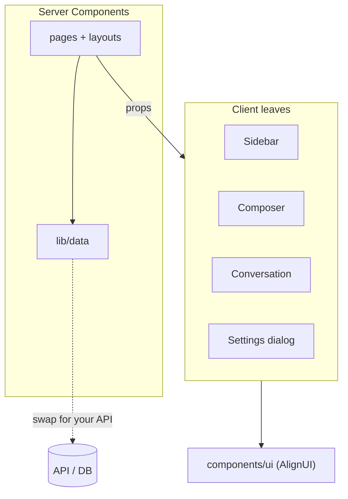

Pages and layouts are Server Components that read from `@/lib/data`. Only interactive leaves are client
components, and they receive data as props.

## Quality and testing

| Script                             | What it does                                                                |
| ---------------------------------- | --------------------------------------------------------------------------- |
| `dev` / `build` / `start`          | Next.js                                                                     |
| `typecheck`                        | route types + `tsc --noEmit`                                                |
| `lint` / `format` / `format:check` | ESLint, Prettier with Tailwind class sorting                                |
| `test` / `test:watch`              | Vitest unit tests (data layer, composer, utils)                             |
| `test:e2e`                         | Playwright at 390, 768, 1280, 1440 and 1920 wide; builds and starts the app |
| `design:lint`                      | lints `DESIGN.md` against the spec                                          |
| `design:check`                     | DESIGN.md ↔ CSS drift + class rules                                         |
| `check`                            | typecheck + lint + design:lint + design:check + test                        |

The e2e suite covers the shell at every width (drawer, rail collapse, tooltips), the composer, chat menus, sidebar
search, theme switching, dark-mode borders, the settings dialog (open, close, Back, reload, links, redirects),
projects and the 404 page. CI runs everything on each push and pull request.

> Locally, Playwright uses your installed Chrome. In CI it installs Chromium first.

## Adding an AlignUI component

Copy its source from `https://www.alignui.com/docs/v1.2/ui/<component>` into `src/components/ui/<component>.tsx`,
install the Radix package it imports, and run `npm run design:check`: some docs snippets still use Tailwind v3
syntax, and the check points at the exact line to fix.

## Roadmap

- [ ] Streaming responses through the AI SDK
- [ ] Authentication
- [ ] Persisted chats and projects (database adapter)
- [ ] File uploads

Ideas and pull requests are welcome. See [CONTRIBUTING.md](./CONTRIBUTING.md).

## Credits

- [AlignUI](https://www.alignui.com) for the free, MIT-licensed base components and tokens this starter is built on.
  The layout is inspired by AlignUI's AI template; no AlignUI Pro code is included.
- [Radix UI](https://www.radix-ui.com), [Remix Icon](https://remixicon.com), [Inter](https://rsms.me/inter/),
  [Next.js](https://nextjs.org) and [Tailwind CSS](https://tailwindcss.com).

Third-party licenses are listed in [THIRD_PARTY_NOTICES.md](./THIRD_PARTY_NOTICES.md).

> This is an independent project, not affiliated with or endorsed by AlignUI.

## License

[MIT](./LICENSE) © Ayush Pratap Singh
